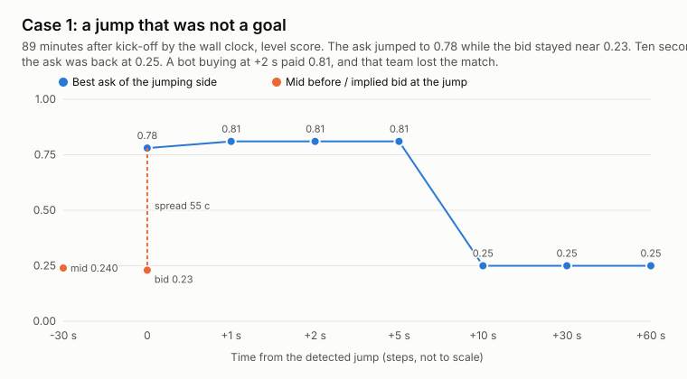
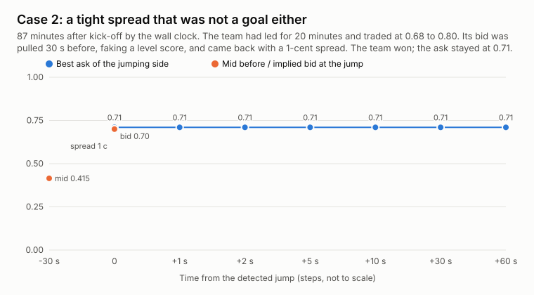

# Two late jumps, second by second

Both cases are rows of [`data/late_goal_jumps.csv`](data/late_goal_jumps.csv). Prices are the jumping team's Yes best ask on the
recorded Polymarket order book, at the detection and 1, 2, 5, 10, 30 and 60 seconds later. The implied bid at the detection is
2 x mid minus ask. Minutes are wall clock since the scheduled kick-off, about 17 more than the minute of play.

## Case 1: a jump that was not a goal

`2026-09-18 09:58:59 UTC`, event `idn2-pja-tor-2026-09-18`, market "Will Persipura Jayapura win on 2026-09-18?", 89 minutes after
kick-off by the wall clock (about the 72nd minute of play).

| Moment | What the book showed |
|---|---|
| 30 s before | Draw the favorite at 0.595, Persipura mid 0.24 |
| Detection | Mid 0.505, but the ask was 0.78 and the bid about 0.23: a 55-cent spread |
| +1 to +5 s | Ask 0.81 |
| +10 s and later | Ask back at 0.25 |
| Result | Persipura did not win (the match ended in a draw) |

The mid-price doubled because the sellers stepped away from the book while the bid stayed where it was. A bot that read the mid as
a goal and bought at +2 seconds paid 0.81 and lost $10.10 including the fee.

The same match fired three more times in the next 18 minutes, for both teams (rows 10:00:28, 10:15:47 and 10:16:42), each time
with an ask of 0.96 or 0.97 and a mid near 0.5. Neither team won: the match ended in a draw. A rule that watches only the mid would
have counted each of these gaps as a goal.

## Case 2: a tight spread that was not a goal either

`2026-09-19 03:27:16 UTC`, event `fpd-per-spo-2026-09-18`, market "Will Sporting FC win on 2026-09-18?", 87 minutes after kick-off
by the wall clock (about the 70th minute of play).

| Moment | What the book and the chain showed |
|---|---|
| About 20 minutes before | Sporting traded at 0.45 to 0.46 until 03:02 UTC, then at 0.64 at 03:06:50 and 0.76 at 03:07:46: a goal. It traded at 0.68 to 0.80 until 03:23 UTC |
| 30 s before | The bids on Sporting and on the draw were pulled: Sporting mid 0.415, draw mid 0.465 (the three mids add up to 1.16) |
| Detection | The bids came back: mid 0.705, ask 0.71, bid about 0.70, a 1-cent spread |
| +1 to +60 s | Ask 0.71 at every recorded step |
| Result | Sporting won |

This is the mirror image of Case 1. Sporting already led, but with its bids pulled for a moment the three mids made the score look
level, so the return of the normal book looked like a late goal with a tight spread. The bet at +2 seconds won: $10 at 0.71
returned about $13.94 after the fee. It won because Sporting was already ahead, at a price that already reflected the lead.

## What to take from the two cases

- Check the spread before you treat a jump as a goal. In our data 627 of 837 jumps had a spread of 20 cents or more at the jump,
  and the jumping side won only 36% of them.
- A tight spread at the jump is not proof of a goal either. The "level score" before the jump is read from mids too, and pulled
  quotes can fake it, as in Case 2: in 51 of the 85 tight-spread jumps the three mids 30 seconds before added up to more than 1.10.
  The 19 tight-spread jumps with a clean book before (mids summing to 0.95 to 1.05) returned -$0.65 per $10 at +2 seconds (t -0.4),
  too few to say more.
- Either way, the whole tight-spread group lost $0.51 per $10 at +2 seconds (85 jumps, t -0.8).
