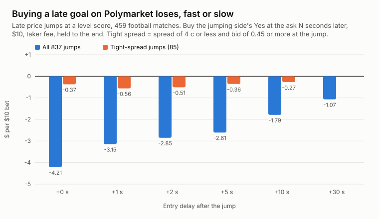
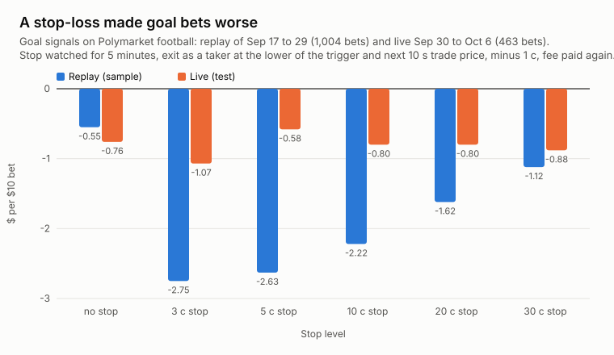

# Polymarket football late goal and stop-loss backtest

**Issue 3, October 2026.** Research by the [OrcaLayer](https://orcalayer.com) team on a recorded order book of every Polymarket
football (soccer) market, September 17 to October 6, 2026, tested on live (in-play) prices.

Write-up: [Polymarket Live Football: Late Goals and Stop-Losses Don't Pay](https://orcalayer.com/blog/polymarket-live-football-late-goals-stop-loss).
Earlier issues: [arbitrage, market making, pre-goal wallets](https://github.com/orcalayer/polymarket-arbitrage-market-making-copy-trading-backtests)
and [copy trading top whales](https://github.com/orcalayer/polymarket-copy-trading-whales-backtest).

## The questions

1. Late in a level football match, one team's price jumps. Can you make money buying that team a few seconds later?
2. If you bet on goal signals, does a stop-loss improve the result?

## Short answer

No and no.

| Idea | Tested | Result |
|---|---|---|
| Buy a late jump at a level score | 837 jumps, 459 matches, 14 match days | -$2.85 per $10 at +2 s (t -7.9); every entry delay from 0 to 30 s loses |
| Buy only tight-spread jumps (spread <= 4 c, bid >= 0.45) | 85 jumps, 76% won | -$0.51 per $10 at +2 s (t -0.8); in 51 of them the three mids before the jump summed to more than 1.10, a sign the level score itself was pulled quotes |
| Stop-loss on goal-signal bets | 1,004 replayed signals, 463 live | All 28 stop settings worse than holding on the replay (-$1.07 to -$2.87 vs. -$0.55); none clearly better than holding live |





## Read more

- [CASES.md](CASES.md): two late jumps, second by second: a pulled ask (a wide-spread jump in a match that ended in a draw) and
  pulled bids (a tight-spread jump in a match one team already led). Neither was a late goal.
- [METHOD.md](METHOD.md): exactly how the data was recorded and tested, and the pitfalls we hit (event order, mid vs. spread,
  a faked level score, overlapping day files, the taker delay, in-play noise for stops).

## Data (`data/`)

| File | Contents |
|---|---|
| `late_goal_jumps.csv` | One row per late jump at a level score (837): time (UTC), event slug, market question, minutes since kick-off (wall clock; about 17 more than match minutes), the three mids 30 seconds before, the side's mid at the detection, the side's best ask 0 / 1 / 2 / 5 / 10 / 30 / 60 seconds after, and whether that side won |
| `stop_loss_goal_signals.csv` | Stop-loss grid: subset (all signals, strong signals, and both again for about the 70th minute and later), stop size in cents, watch window, result per $10 (mean, t, n) on the replay sample and on the live test, and how many stops fired |

No wallet addresses anywhere. Market slugs and questions are public Polymarket data.

## Recompute the numbers

`scripts/summarize_late_goals.py` (Python 3.9+, standard library only) recomputes every late-goal table of the write-up from
`data/late_goal_jumps.csv`:

```bash
python3 scripts/summarize_late_goals.py data/late_goal_jumps.csv
```

Its output is in [`results/late_goals_summary.txt`](results/late_goals_summary.txt). The stop-loss study used on-chain trade paths
after each signal; the CSV holds its full result grid.

These tests need a recorded order book (best bid and ask every few milliseconds), which public APIs do not keep historically.
To look at live markets and wallets yourself, the free [OrcaLayer MCP server](https://orcalayer.com/docs/mcp) works from Claude
(Settings, Connectors, Add custom connector, `https://orcalayer.com/mcp`), and the [OrcaLayer API](https://orcalayer.com/docs/api)
has full trade histories (Premium).

## Method

- **Order book:** our recorder of the Polymarket CLOB WebSocket (`price_change`, `book`, `last_trade_price`) for every football
  market since 2026-09-17; 99.9% of on-chain trades are present, 97.6% at the recorded best price.
- **Late jump:** 1X2 markets; wall clock at least 87 minutes after kick-off (about the 70th minute); 30 seconds before, the draw had
  the highest mid of the three; the side's Yes mid rose by 0.25 or more within 30 seconds to 0.50 or higher; one detection per side
  per match per 10 minutes; asks are taken after the first book update at or after each offset. Scanned days: 2026-09-17 to 09-29 and 10-05 (09-30 to 10-04 not scanned). Day files overlap after
  midnight UTC; the 48 duplicate rows this produced are removed (885 raw rows, 837 jumps). Spread = ask minus implied bid
  (2 x mid minus ask) at the detection, rounded to the cent.
- **Bet:** $10 at the recorded best ask (only asks above 0.02 and up to 0.97), sports taker fee 0.05 x p x (1 - p) per share, held to
  resolution. Polymarket holds taker orders for 1 second in live football, so +2 s is a realistic entry.
- **Stop-loss:** goal signals from our goal detector (several linked markets of a match repricing at once, as in issue 1) at three
  sensitivity settings; one goal can fire more than one setting, and every signal is counted as a bet. Replay 2026-09-17 to 09-29 (sample), live 2026-09-30 to 10-06 (test). Entry at the recorded ask +1 s. Stop
  X cents below entry, watched for W minutes (2, 5, 15, to the end), triggered by the first on-chain trade at or below it; exit at
  the lower of the trigger price and the volume-weighted trade price of the next 10 seconds, minus 1 cent, fee paid again; no
  trigger means hold to resolution. "Strong signals" = the larger moves, as flagged by the detector at the signal.
- **Statistics:** mean per $10 and the plain t-statistic.

## Caveats

About three weeks of football (late jumps: 14 days), mostly club leagues plus one international week. Pre-match markets and other
sports were not tested. A wallet that sees the goal before the book moves plays a different game (see issue 1). This is research,
not financial advice.

## License

Text and data: [CC BY 4.0](https://creativecommons.org/licenses/by/4.0/). Use freely, credit "OrcaLayer Research" with a link.
